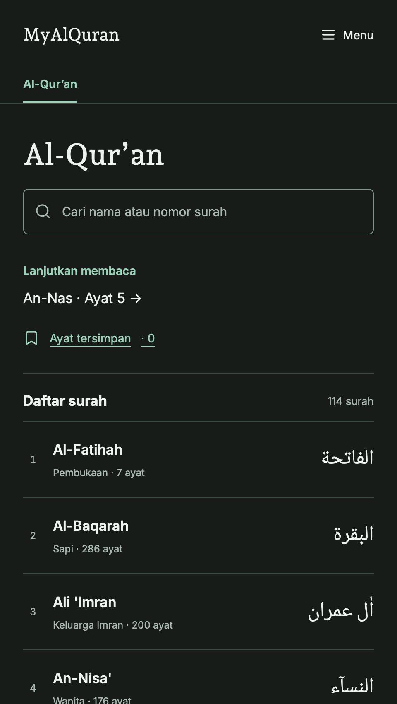
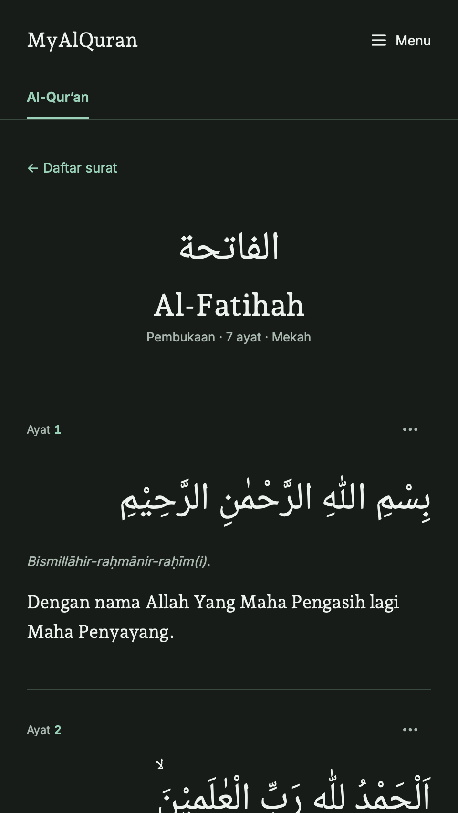
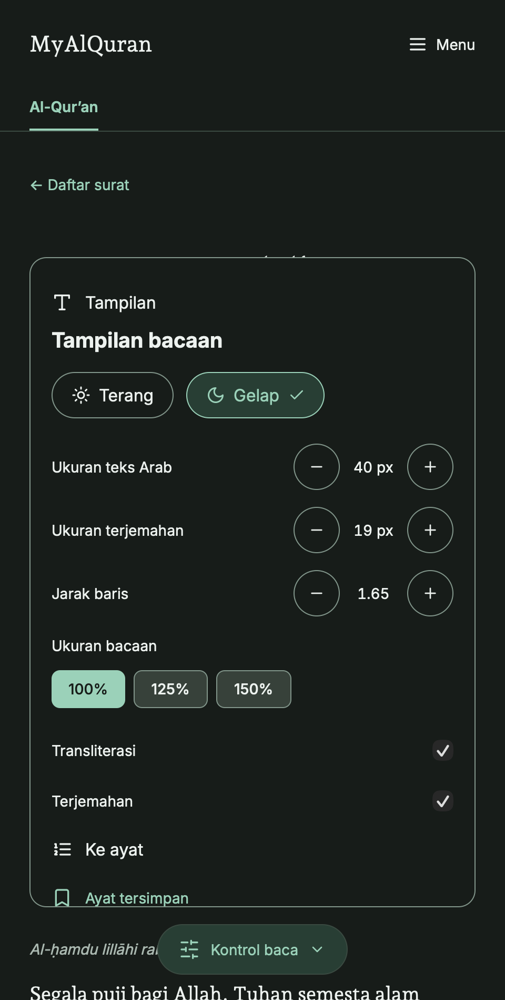

# MyAlQuran

A focused, multilingual Quran reader with translations, tafsir, personal bookmarks, and offline reading. Built with Astro, React islands, and a local SQLite content archive.

[Open the Cloudflare preview](https://preview.myalquran-4c7.pages.dev) · [GitHub repository](https://github.com/bangadam/myalquran)

**Preview release:** Quran translations and tafsir are available in four languages. The prayer collection is currently available in Indonesian; other locales explicitly disclose this limitation. Content rights and editorial review remain release requirements.

## App preview

Screenshots below show the running application, not design mockups. The reader keeps a centered, single-column layout with a maximum width of 480px on larger screens.

| Surah directory | Quran reader | Reading preferences |
| --- | --- | --- |
|  |  |  |

## Features

- **Read without an account.** All 114 surahs, with Arabic text and verse-level navigation.
- **Four interface languages.** Bahasa Indonesia, English, 日本語, and 简体中文.
- **Translations and tafsir.** Edition credits, source links, and available translator footnotes remain visible.
- **Personal reading preferences.** Independent Arabic and translation sizes, line spacing, transliteration visibility, and light/dark themes.
- **Pick up where you left off.** Last reading position and bookmarks stay in the browser on your device.
- **Find a passage quickly.** Search surahs by name or number, browse prayers, or jump to a verse.
- **Download for offline reading.** Explicit per-language downloads, resource integrity checks, recoverable failures, and user-controlled updates.
- **Content-first rendering.** Reading content and ordinary navigation render as HTML; JavaScript enhances preferences, bookmarks, search, and offline support.

## Language coverage

| Content | Indonesian | English | Japanese | Simplified Chinese |
| --- | --- | --- | --- | --- |
| Interface | Available | Available | Available | Available |
| Arabic Quran | 114 surahs | 114 surahs | 114 surahs | 114 surahs |
| Verse translations | 6,236 verses | 6,236 verses | 6,236 verses | 6,236 verses |
| Tafsir | Available | Available | Available | Available |
| Prayers | 227 entries | Indonesian fallback disclosed | Indonesian fallback disclosed | Indonesian fallback disclosed |

Availability is calculated from the validated database. Missing translations are never silently presented as translated content.

## Run locally

### Requirements

- Node.js **22.13 or later**; Node 22.22.3 was used during development.
- npm.
- Python 3 for the complete test suite and content-maintenance tools.

```sh
npm ci
npm run dev
```

Open the local URL printed by Astro. The app reads `data/quran.sqlite` at development/build time; no database server or API key is required.

### Commands

| Command | Purpose |
| --- | --- |
| `npm run dev` | Start the development server |
| `npm run check` | Check Astro and TypeScript |
| `npm test` | Run content, import, and offline-state regression checks |
| `npm run check:release` | Require complete religious content across all four locales |
| `npm run build` | Generate static pages and offline resource manifests in `dist/` |
| `npm run preview` | Serve the generated build locally |

The release check currently reports missing prayer translations for `en`, `ja`, and `zh-Hans`. A successful build or test run is not a claim of complete multilingual content or verified republication rights.

## Architecture

```text
Local SQLite archive
        ↓
Schema and content validation
        ↓
Astro static HTML + React interaction islands
        ↓
HTML / CSS / JavaScript / local fonts / offline manifests
        ↓
HTTPS hosting + browser service worker
```

| Layer | Technology |
| --- | --- |
| Pages | Astro 7, static output |
| Interactive controls | React 19, shadcn/ui, Radix |
| Styling | Tailwind CSS 4, shared design tokens |
| Typography | Self-hosted Inter, Andada Pro, Noto Naskh Arabic |
| Icons | Lucide |
| Content | SQLite via Node's built-in `node:sqlite`, validated with Zod |
| Offline | Workbox, service worker, Cache API, Web Locks |

The SQLite archive is **not shipped to the browser**. Reading does not fetch religious content or fonts from third-party services.

```text
data/                  Content database and maintenance archives
src/pages/             Localized directories, readers, settings, and fallbacks
src/components/        Reader controls, theme controls, and offline UI
src/lib/               Content validation, localization, and offline client
src/scripts/           Bookmark, reading-position, and search behavior
src/styles/            Shared typography, tokens, and responsive layout
src/sw.ts              Offline package validation and request handling
scripts/               Tests, content importers, and build integrations
docs/screenshots/      Screenshots of the running application
```

## Offline reading and privacy

Installing the app and downloading a language are separate actions. Open **Menu → Downloads** and explicitly save a language before relying on offline access.

Each resource is checked against its manifest before a complete package becomes active. Failed updates preserve the previous package, and missing/corrupted resources can be repaired. Browser storage can be evicted; verify download status before travelling.

Bookmarks, reading position, display preferences, and downloaded content are stored locally in the browser. They do not sync between devices. Clearing site data removes them. The hosting provider may still process ordinary request metadata.

## Cloudflare deployment

The application is a static site: upload **`dist/` only**, never the source database or repository directory. The Cloudflare deployment for this iteration is a preview, not a complete production release.

After a local build, a Cloudflare Pages Direct Upload preview can be published with:

```sh
npx --yes wrangler@4.149.0 pages deploy dist --project-name=myalquran --branch=preview
```

A Cloudflare account, authenticated Wrangler session, and Pages project are required. Direct Upload does not configure automatic deployments from GitHub. See [Cloudflare's Direct Upload guide](https://developers.cloudflare.com/pages/get-started/direct-upload/).

## Content sources and rights

Religious text is preserved from the project's content archive; the application does not generate or rewrite Quran translations or tafsir.

- Japanese verse translation: [Saeed Sato / QuranEnc](https://quranenc.com/en/browse/japanese_saeedsato), edition 1.0.13.
- Chinese verse translation: [QuranEnc Chinese translation](https://quranenc.com/en/browse/chinese_suliman), edition 1.0.8.
- Japanese and Chinese tafsir: Al-Mukhtasar through [QuranEnc](https://quranenc.com/en/home/api/), edition 1.0.0.
- English tafsir: [Al-Mukhtasar through QUL](https://qul.tarteel.ai/resources/tafsir/266), with Tafsir Center attribution and recorded source provenance.
- Fonts: SIL Open Font License notices are included in `src/assets/fonts/`.

QuranEnc republication has conditions, including text preservation, attribution, version information, and following source updates. Existing Indonesian and English dataset permissions still require verification. Public repository visibility does **not** establish a blanket license for code or bundled content. No project-wide software license has been selected.

Detailed edition records, importer behavior, source research, and historical verification are preserved in [implementation notes](docs/implementation-notes.md).

## Quality and limitations

The automated suite covers verse numbering, Arabic consistency, translation contracts, optional prayer fields, atomic imports, resource integrity, cancellation, and offline recovery. Browser smoke checks exercise search, reader controls, verse jumps, bookmarks, theme selection, and language links.

Remaining work includes full screen-reader testing, physical-device installation, mobile viewport verification, storage-pressure scenarios, outstanding content permissions, and the missing prayer translations. Desktop screenshots are not evidence of mobile-device testing.

## Project documentation

- [Product requirements](PRD.md)
- [Architecture](ARCHITECTURE.md)
- [Design system](DESIGN.md)
- [Implementation and source notes](docs/implementation-notes.md)

## Contributing

Keep changes focused and run `npm run check` and `npm test`. Content contributions must include verified source provenance, publication permission, stable verse/prayer identities, and the original text. Do not substitute generated religious content, remove attribution, or weaken release checks to make an incomplete dataset appear complete.
