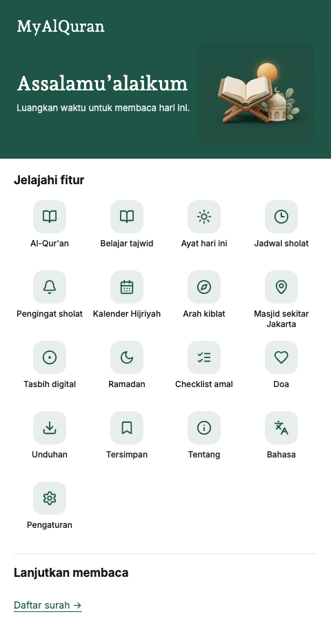

# MyAlQuran

A focused, multilingual Quran reader with translations, tafsir, prayers, devotional tools, personal bookmarks, and offline reading. Built with Astro, React islands, and a local SQLite content archive.

[Open the Cloudflare preview](https://preview.myalquran-4c7.pages.dev) · [GitHub repository](https://github.com/bangadam/myalquran)

**Preview release:** Quran translations and tafsir are available in four languages. The prayer collection is currently available in Indonesian; other locales explicitly disclose this limitation. Content rights and editorial review remain release requirements.

## App preview

These screenshots show the running v2 shell in Indonesian at a 480px-wide Chromium viewport (device pixel ratio 1). The reader remains a centered, single-column layout with a maximum width of 480px on larger screens.

| Home | Surah directory | Quran reader |
| --- | --- | --- |
|  |  |  |

## Features

- **Read without an account.** All 114 surahs and 6,236 verses, with Arabic text, translations and tafsir in each of four locales; publisher/edition credits, source links and available translator footnotes remain visible.
- **Four interface languages.** Bahasa Indonesia, English, 日本語, and 简体中文. The prayer collection has 227 Indonesian entries; English, Japanese and Chinese prayer pages explicitly disclose their Indonesian fallback rather than presenting it as localized content.
- **Home (`/` for Indonesian, `/{locale}/` for each locale).** The landing page renders directly without a redirect or JavaScript. Service links, last-reading position from device storage, and a daily-verse block are shared across the entry routes. Its 15 archived references resolve Arabic and locale translations from the validated local corpus; JavaScript rotates the selection by UTC date, while a verse remains available without JavaScript.
- **Read and study.** Open the searchable 114-surah directory at `/{locale}/surat/`, search by name or number, jump to a verse, browse grouped prayers, and consult a tajwid-rule reference. Tajwid rule names and explanations are Indonesian/Arabic source material, not verified translations into the other languages; editorial review remains outstanding.
- **Personal reading and devotional controls.** Independent Arabic/translation sizes, line spacing, transliteration visibility and light/dark themes; locally stored last position and saved verses. Digital tasbih counts eight archived dhikr presets with device-local progress and a confirmed reset.
- **Hijri calendar and qibla.** Browse only the archived 1448 AH calendar snapshot, not a live/current calendar. Qibla shows a locally computed bearing from manual coordinates (Jakarta is the disclosed default); device geolocation and orientation sensor are optional, on request.
- **Mosques and prayer times.** Mosque listings are a dated OpenStreetMap snapshot of 959 objects within 5 km of central Jakarta, not a live nearby search; data © OpenStreetMap contributors, ODbL ([attribution](https://www.openstreetmap.org/copyright)). Prayer times are locally approximated for selectable archived cities and calculation methods, not a local religious authority's ruling.
- **Prayer reminders and Ramadan.** Choose prayer reminders and before/after offsets; notification delivery runs only while the reminder page remains open, with no background scheduling. Ramadan combines archived prayers and links to existing prayer/verse records with a device-local daily nine-item amal checklist and khatam progress.
- **Download for offline reading.** Explicit per-language packages, resource integrity checks, recoverable failures and user-controlled updates. Ordinary reading content and navigation render as HTML; JavaScript enhances preferences, bookmarks, search and offline support.

## Language coverage

| Content | Indonesian | English | Japanese | Simplified Chinese |
| --- | --- | --- | --- | --- |
| Interface | Available | Available | Available | Available |
| Arabic Quran | 114 surahs / 6,236 verses | 114 / 6,236 | 114 / 6,236 | 114 / 6,236 |
| Verse translations | 114 surahs / 6,236 verses | 114 / 6,236 | 114 / 6,236 | 114 / 6,236 |
| Tafsir | 114 surahs / 6,236 verses | 114 / 6,236 | 114 / 6,236 | 114 / 6,236 |
| Prayers | 227 Indonesian entries | No localized document; 227 Indonesian fallback entries disclosed | No localized document; 227 Indonesian fallback entries disclosed | No localized document; 227 Indonesian fallback entries disclosed |

Availability is calculated from the validated database. Missing translations are never silently presented as translated content. Feature-only labels may be localized while archived devotional/religious text remains Indonesian or Arabic with its source language indicated.

## Run locally

### Requirements

- Node.js **22.13 or later**; Node 22.22.3 was used during development.
- npm.
- Python 3 for the complete test suite and content-maintenance tools.

```sh
npm ci
npm run dev
```

Open the local URL printed by Astro: `/` is the Indonesian Home, `/{locale}/` is localized Home, `/{locale}/surat/` is the surah directory, and `/{locale}/bahasa/` has the four-language picker and content-availability table. The app reads `data/quran.sqlite` at development/build time; no database server or API key is required.

### Commands

| Command | Purpose |
| --- | --- |
| `npm run dev` | Start the development server |
| `npm run check` | Check Astro and TypeScript |
| `npm test` | Run content, import, and offline-state regression checks |
| `npm run check:release` | Require complete religious content across all four locales |
| `npm run build` | Generate static pages and offline resource manifests in `dist/` |
| `npm run preview` | Serve the generated build locally |

The release check currently reports missing prayer translations for `en`, `ja`, and `zh-Hans`. A successful build or test run is not a claim of complete multilingual content or verified republication rights.

## Architecture

```text
Local SQLite archive
        ↓
Schema and content validation
        ↓
Astro static HTML + React interaction islands
        ↓
HTML / CSS / JavaScript / local fonts / offline manifests
        ↓
HTTPS hosting + browser service worker
```

| Layer | Technology |
| --- | --- |
| Pages | Astro 7, static output |
| Interactive controls | React 19, shadcn/ui, Radix |
| Styling | Tailwind CSS 4, shared design tokens |
| Typography | Self-hosted Inter, Andada Pro, Noto Naskh Arabic |
| Icons | Lucide |
| Content | SQLite via Node's built-in `node:sqlite`, validated with Zod |
| Offline | Workbox, service worker, Cache API, Web Locks |

The SQLite archive is **not shipped to the browser**. Reading does not fetch religious content or fonts from third-party services.

```text
data/                  Content database and maintenance archives
src/pages/             Localized Quran, prayers, Home, devotional tools, settings, and fallbacks
src/components/        Reader controls, theme controls, and offline UI
src/lib/               Content validation, localization, prayer calculations, devotional data, and offline client
src/scripts/           Bookmark, reading-position, and search behavior
src/styles/            Shared typography, tokens, and responsive layout
src/sw.ts              Offline package validation and request handling
scripts/               Tests, content importers, and build integrations
docs/screenshots/      Screenshots of the running application
```

## Offline reading and privacy

Installing the app and downloading a language are separate actions. Open **Unduhan** from Home (or visit `/{locale}/offline/`) and explicitly save a language before relying on offline access.

Each resource is checked against its manifest before a complete package becomes active. Failed updates preserve the previous package, and missing/corrupted resources can be repaired. Browser storage can be evicted; verify download status before travelling.

Bookmarks, reading position, display preferences, and downloaded content are stored locally in the browser. They do not sync between devices. Clearing site data removes them. The hosting provider may still process ordinary request metadata.

## Cloudflare deployment

The application is a static site: upload **`dist/` only**, never the source database or repository directory. The Cloudflare deployment for this iteration is a preview, not a complete production release.

After a local build, a Cloudflare Pages Direct Upload preview can be published with:

```sh
npx --yes wrangler@4.149.0 pages deploy dist --project-name=myalquran --branch=preview
```

A Cloudflare account, authenticated Wrangler session, and Pages project are required. Direct Upload does not configure automatic deployments from GitHub. See [Cloudflare's Direct Upload guide](https://developers.cloudflare.com/pages/get-started/direct-upload/).

## Content sources and rights

Religious text is preserved from the project's content archive; the application does not generate or rewrite Quran translations or tafsir.

- Japanese verse translation: [Saeed Sato / QuranEnc](https://quranenc.com/en/browse/japanese_saeedsato), edition 1.0.13.
- Chinese verse translation: [QuranEnc Chinese translation](https://quranenc.com/en/browse/chinese_suliman), edition 1.0.8.
- Japanese and Chinese tafsir: Al-Mukhtasar through [QuranEnc](https://quranenc.com/en/home/api/), edition 1.0.0.
- English tafsir: [Al-Mukhtasar through QUL](https://qul.tarteel.ai/resources/tafsir/266), with Tafsir Center attribution and recorded source provenance.
- Fonts: SIL Open Font License notices are included in `src/assets/fonts/`.

QuranEnc republication has conditions, including text preservation, attribution, version information, and following source updates. Existing Indonesian and English dataset permissions still require verification. Public repository visibility does **not** establish a blanket license for code or bundled content. No project-wide software license has been selected.

Detailed edition records, importer behavior, source research, and historical verification are preserved in [implementation notes](docs/implementation-notes.md).

## Quality and limitations

The automated suite covers verse numbering, Arabic consistency, translation contracts, optional prayer fields, atomic imports, resource integrity, cancellation, and offline recovery. The prayer calculation self-check compares 4,650 prayer times with one archived provider/month; it does not establish religious-authority equivalence. The v2 dev-server route smoke covered the four locales, Home, the reader, settings, tajwid, tasbih, calendar, qibla, mosque listings, schedule, reminders and Ramadan; see [implementation notes](docs/implementation-notes.md) for the recorded scope.

The v2 reader-dock geometry was browser-verified in Chromium/Playwright at 480×900 and 390×844: at the end of `/{locale}/surat/1/`, the last verse ends around 550px, the fixed dock starts around 740px, and the bottom navigation around 823px, leaving the verse clear and the navigation uncovered. Still unverified: geolocation/orientation/notification permission paths, full screen-reader use, physical mobile devices, reduced-motion/forced-colors and storage-pressure scenarios. Content rights and religious-editorial review remain open, as do localized prayers and background reminder delivery. A production build and preview deployment for v2 are being performed as part of this release; their outcomes are not asserted here.

## Project documentation

- [Product requirements](PRD.md)
- [Architecture](ARCHITECTURE.md)
- [Design system](DESIGN.md)
- [Implementation and source notes](docs/implementation-notes.md)

## Contributing

Keep changes focused and run `npm run check` and `npm test`. Content contributions must include verified source provenance, publication permission, stable verse/prayer identities, and the original text. Do not substitute generated religious content, remove attribution, or weaken release checks to make an incomplete dataset appear complete.
